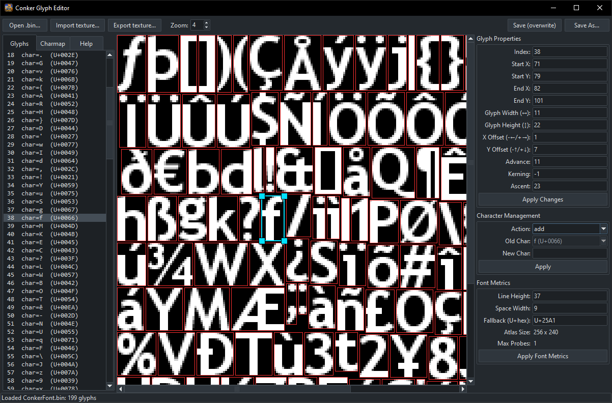

[](README.md)
[](README_RU.md)

# Conker Glyph Editor

A visual bitmap font editor for **Conker: Live & Reloaded** (Xbox). It allows you to inspect, edit glyph metrics and rectangles, manage the character map, and replace the embedded Gray8 texture atlas for `default.bin` files (CAFF format `CAFF28.01.05.0031`).

## Features
* **Visual Editing:** Move and resize glyph rectangles directly on the texture atlas with corner handles.
* **Metrics Editing:** Edit coordinates, cell sizes, offsets, advance, kerning, and ascent values.
* **Character Management:** Add, remove, replace, or remap Unicode code points to glyphs using an open-addressed hash table (2048 slots).
* **Glyph Management:** Add new glyphs (cloned from existing ones) or delete them — the file grows/shrinks automatically while preserving all offsets, checksums, and the charmap's probe chains.
* **Texture Import/Export:** Export the atlas to PNG, or import a new one from PNG/BMP/clipboard (any size with width a multiple of 64, up to 4096).
* **Font Profiles:** Auto-detects and supports `ConkerFont`, `ConkerFontJapanese`, `FrontendTitle`, and `FrontendTitleJapanese`.
* **Font-wide Metrics:** Edit line height, space width, and fallback character.
* **Clipboard Support:** Copy/paste the texture atlas via **Ctrl+C** / **Ctrl+V** (Windows, macOS, Linux with xclip/wl-clipboard).
* **Dark Theme UI:** Built with Tkinter, featuring a modern dark interface.

## Files
* `conker_glyph_editor.py` — the main graphical editor (Tkinter GUI).
* `conker_glyph_format.py` — library for reading/writing the CAFF font format, glyph records, and the open-addressed character map.
* `conker_texture.py` — Gray8 texture reader/writer used by the library and the editor.
* `conker_clipboard.py` — cross-platform clipboard helpers for image copy/paste.

*All files must be located in the same folder.*

## Requirements
* Python 3.8 or later (`tkinter` is included in standard Python distributions).
* [Pillow](https://python-pillow.org/) library.

## Installation & Running

Install the required dependency:
```bash
pip install Pillow
```

> On Linux, copying / pasting the texture with `Ctrl+C` / `Ctrl+V` additionally needs `xclip` (X11) or `wl-clipboard` (Wayland) installed.

Run the editor (optionally passing a font file as an argument):
```bash
python conker_glyph_editor.py [default.bin]
```

> ⚠️ On Windows, you can use either `python` or `py` to run the script, depending on your Python installation.

> ⚠️ On Linux, you may need to use `python3` instead of `python`.

## Screenshot

<p align>
  
</p>
