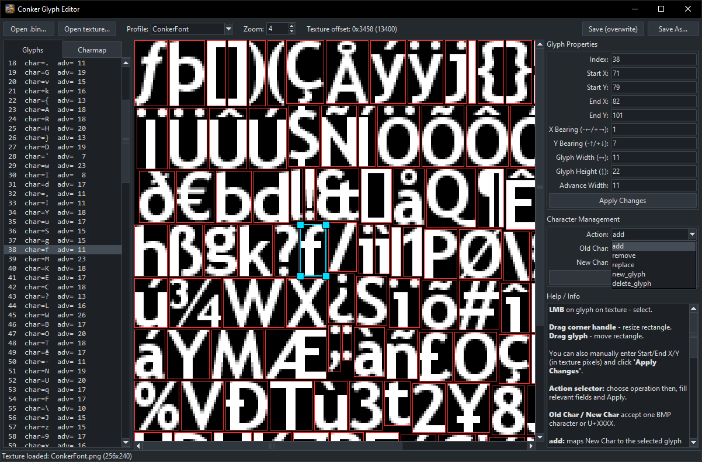

[badge-en]: https://img.shields.io/badge/lang-English%20%F0%9F%87%AC%F0%9F%87%A7-white
[badge-ru]: https://img.shields.io/badge/%D1%8F%D0%B7%D1%8B%D0%BA-%D0%A0%D1%83%D1%81%D1%81%D0%BA%D0%B8%D0%B9%20%F0%9F%87%B7%F0%9F%87%BA-white
[vot-readme-en]: README.md
[vot-readme-ru]: README_RU.md
[![en][badge-en]][vot-readme-en]
[![ru][badge-ru]][vot-readme-ru]

<table>
<tr>
<td width="170">

<p>
  
</p>

</td>
<td>

# Conker Glyph Editor

### A visual glyph editor for Conker: Live & Reloaded fonts (CAFF format).

</td>
</tr>
</table>

## Files

- `conker_glyph_format.py` — library for reading and writing the font format and managing open-addressed character maps (required by the editor)
- `conker_texture.py` — reads and replaces the Gray8 texture embedded in the .bin (used by the library and the editor)
- `conker_clipboard.py` — image clipboard support (copy / paste the texture)
- `conker_glyph_editor.py` — the main graphical editor (tkinter)

All files must be located in the same folder.

## Screenshot

<p align>
  
</p>

## Installation (Windows)

### Option 1 — Download the executable

Download the latest `.exe` version from the [Releases](https://github.com/AS97GitHub/Conker-Glyph-Editor/releases) page.

> No `python` installation or additional dependencies are required.

### Option 2 — Run from source

1. Make sure Python 3.8 or later is installed (tkinter is included with the standard Windows Python distribution, so no separate installation is required).
2. Install Pillow:

   ```
   pip install Pillow
   ```

> On Linux, copying / pasting the texture with `Ctrl+C` / `Ctrl+V` additionally needs `xclip` (X11) or `wl-clipboard` (Wayland) installed.

## Running

> ⚠️ On Windows, you can use either `python` or `py` to run the script, depending on your Python installation.

> ⚠️ On Linux you may need to use `python3` instead of `python`.

```bash
python conker_glyph_editor.py
```

Or launch it directly with the font file:

```bash
python conker_glyph_editor.py path\to\default.bin
```

## Usage

1. **"Open .bin..."** — select a font file (for example, `default.bin` from `ConkerFont`). The **profile** (`ConkerFont` / `ConkerFontJapanese` / `FrontendTitle` / `FrontendTitleJapanese`) is **detected automatically** from a byte signature in the file and the drop-down updates to match; you only need to pick a profile manually if you want to override the detected one. The texture is read out of the .bin itself and shown on the canvas right away.
2. **Texture:** the texture lives inside the .bin.
   - **"Export texture..."** — save it as a PNG (Gray8).
   - **"Import texture..."** — replace it with a PNG/BMP of exactly the same size; the change is written when you save the .bin.
   - **Ctrl+C** copies the texture to the clipboard, **Ctrl+V** imports the clipboard image as the new texture (the shortcuts do not apply while you type in a text field).
3. **Glyphs / Charmap Tabs:** Select a glyph by its index or search assigned characters in the Charmap tab. The selected glyph is highlighted on the texture with a light blue rectangle and corner handles. The Charmap tab also shows the raw empty slots of the fixed charmap hash table.
4. **Visual & Property Editing:**
   - Drag a corner handle to resize the glyph rectangle (`x0/y0/x1/y1`).
   - Drag the center of the rectangle to move it.
   - Manually edit metrics on the right panel and click **"Apply Changes"**:
     - **X Bearing / Y Bearing** — baseline offset (signed -128..127). Negative X shifts the glyph left, positive X shifts it right; positive Y moves it lower, negative Y moves it higher.
     - **Glyph Width / Glyph Height** — physical on-screen size (rescales/stretches the glyph along the X/Y axis).
     - **Advance Width** — horizontal step to the next character.
5. **Character Management:** Select an action from the menu, fill in the relevant fields and click **"Apply"**:
   - **add** — map a new character or code point (a single symbol or `U+XXXX`) to the selected glyph, in addition to its existing characters. Duplicate codes are rejected.
   - **remove** — delete the character chosen in **Old Char** from the selected glyph. A glyph keeps at least one character; removing the last one is rejected.
   - **replace** — reassign the character chosen in **Old Char** to the code point entered in **New Char**.
   - **new_glyph** — append a new glyph at the end of the glyph table as a copy of the selected one, so it is visible and editable right away. **New Char** is optional and maps a character to the new glyph. The file grows: all sizes, offsets and the header checksum are updated automatically.
   - **delete_glyph** — remove the selected glyph: its characters are unmapped and every later glyph moves down by one index. The file shrinks. Asks for confirmation first; cannot be undone once saved.
6. **Saving:**
   - **"Save As..."** — save to a new file.
   - **"Save (overwrite)"** — overwrite the open file.

The editor safely modifies the glyph records and rebuilds the fixed 2048-slot hash table without interrupting probe chains or corrupting unrelated file regions. When glyphs are added or deleted, the whole container is re-laid-out (charmap, alignment padding, texture resource, metadata, section sizes) and the header checksum plus the charmap probe limit are brought up to date on save, so a saved file is always one the game accepts.

## Important Note

The coordinate decoding formula for each font is:

```
pixel = raw / DIV + OFFSET
DIV   = 16384 / actual_texture_size_in_pixels
```

where 16384 = 2¹⁴ — coordinates are stored in a fixed 14-bit normalized grid.

The texture rectangle coordinate formula (`x0/y0/x1/y1`) is derived empirically, while rendering properties (**X/Y Bearing**, **Glyph Width/Height**, and **Advance Width**) are separately **confirmed in-game via XEMU**. Verify your changes in-game when doing large-scale modifications.

---

Not affiliated with Microsoft / Rare. All trademarks are property of their
respective owners. Intended for non-commercial use (translations, modding,
format research).