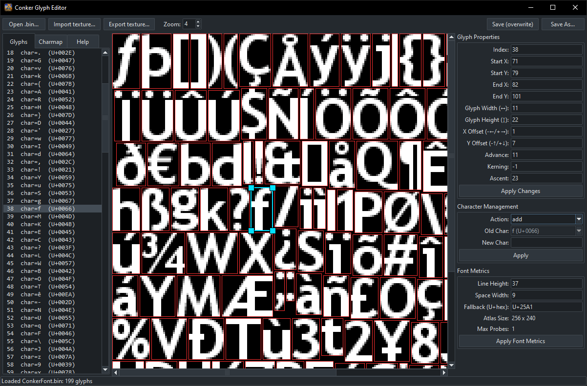

[](README.md)
[](README_RU.md)

# Conker Glyph Editor

Визуальный редактор растровых шрифтов для **Conker: Live & Reloaded** (Xbox). Позволяет просматривать, редактировать метрики и прямоугольники глифов, управлять таблицей символов и заменять встроенную Gray8 текстуру-атлас в файлах `default.bin` (CAFF формат `CAFF28.01.05.0031`).

## Возможности
* **Визуальное редактирование:** Перемещение и изменение размера прямоугольников глифов прямо на текстуре с помощью угловых маркеров.
* **Редактирование метрик:** Изменение координат, размеров ячеек, смещений, ширины продвижения, кернинга и вылета.
* **Управление символами:** Добавление, удаление, замена или переназначение Unicode-кодов глифам через хеш-таблицу с открытой адресацией (2048 слотов).
* **Управление глифами:** Добавление новых глифов (копированием существующих) или их удаление — файл автоматически растёт/сжимается с сохранением всех смещений, контрольных сумм и цепочек проб хеш-таблицы.
* **Импорт/Экспорт текстур:** Экспорт атласа в PNG или импорт нового из PNG/BMP/буфера обмена (любой размер с шириной, кратной 64, до 4096).
* **Профили шрифтов:** Автоматическое определение и поддержка шрифтов `ConkerFont`, `ConkerFontJapanese`, `FrontendTitle` и `FrontendTitleJapanese`.
* **Общие метрики шрифта:** Редактирование высоты строки, ширины пробела и резервного символа (fallback).
* **Буфер обмена:** Копирование/вставка текстуры-атласа через **Ctrl+C** / **Ctrl+V** (Windows, macOS, Linux с xclip/wl-clipboard).
* **Тёмная тема:** Интерфейс на базе Tkinter с современным тёмным оформлением.

## Файлы
* `conker_glyph_editor.py` — основной графический редактор (GUI на Tkinter).
* `conker_glyph_format.py` — библиотека для чтения/записи формата шрифта CAFF, записей глифов и хеш-таблицы символов с открытой адресацией.
* `conker_texture.py` — чтение/запись Gray8 текстур, используемое библиотекой и редактором.
* `conker_clipboard.py` — кроссплатформенные помощники для копирования/вставки изображений через буфер обмена.

*Все файлы должны находиться в одной папке.*

## Требования
* Python 3.8 или новее (`tkinter` входит в стандартную поставку Python).
* Библиотека [Pillow](https://python-pillow.org/).

## Установка и запуск

Установите необходимую зависимость:
```bash
pip install Pillow
```

> On Linux, copying / pasting the texture with `Ctrl+C` / `Ctrl+V` additionally needs `xclip` (X11) or `wl-clipboard` (Wayland) installed.

Запустите редактор (можно сразу указать путь к файлу шрифта):
```bash
python conker_glyph_editor.py [default.bin]
```

> ⚠️ В Windows для запуска скрипта можно использовать `python` или `py` — в зависимости от того, как установлен Python.

> ⚠️ В Linux вместо `python` может потребоваться использовать `python3`.

## Скриншот

<p align>
  
</p>
